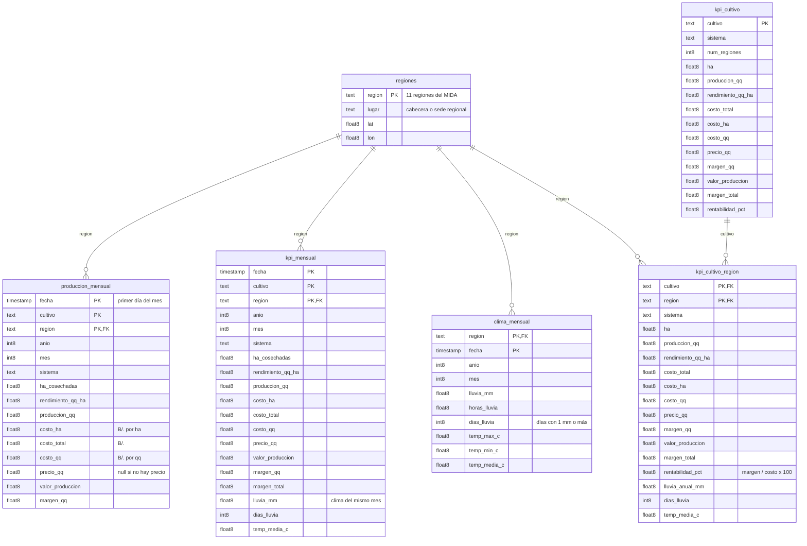

# Modelo de datos (PostgreSQL, esquema `agro`)

Tablas que crea `scripts/exportar_postgres.py` a partir de MongoDB y que lee Power BI. Año agrícola 2025–2026, mercado nacional de Panamá. Unidades: qq = quintal (100 lb), B/. = balboas, ha = hectáreas.

Las claves (PK/FK) son lógicas: indican cómo relacionar las tablas en Power BI, pero la base no las impone.

## De dónde sale cada tabla

| Tabla | Origen en MongoDB | Granularidad |
|---|---|---|
| `regiones` | `LOCALIZACIONES` en `scripts/descargar_clima.py` | 1 fila por región |
| `produccion_mensual` | colección `produccion_mensual` (CSV sintético) | cultivo × región × mes |
| `clima_mensual` | `mongodb/pipelines/01_clima_mensual.json` | región × mes |
| `kpi_mensual` | `mongodb/pipelines/02_kpi_mensual.json` | cultivo × región × mes, con clima |
| `kpi_cultivo_region` | `mongodb/pipelines/03_kpi_cultivo_region.json` | cultivo × región (año agrícola) |
| `kpi_cultivo` | `mongodb/pipelines/04_kpi_cultivo.json` | cultivo (nacional) |

`kpi_mensual` ya incluye todas las columnas de `produccion_mensual`; en Power BI usar una de las dos para no duplicar totales.
